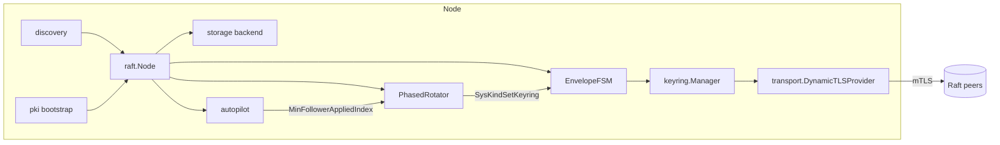
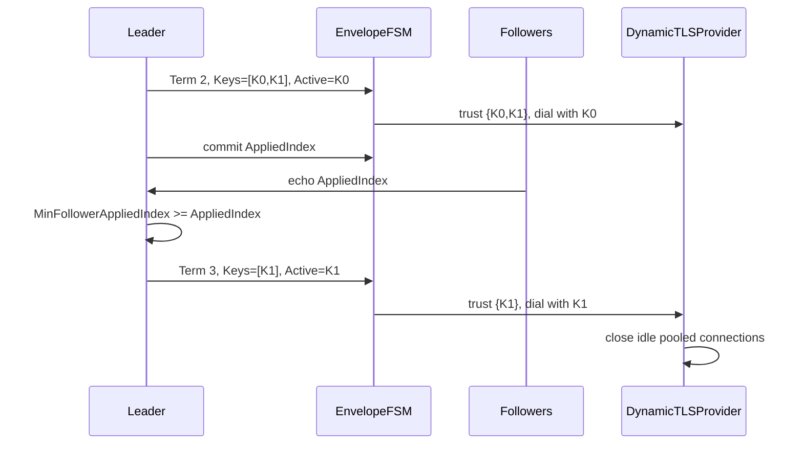

# raft

[](https://github.com/disaster37/raft/actions/workflows/ci.yml)
[](LICENSE)

Production-grade shared Raft library for Go: HashiCorp Raft + BoltDB +
Kubernetes StatefulSet DNS discovery + dynamic mTLS + Vault-style in-band
phased TLS keyring rotation + autopilot + HTTP probes/leader forwarding.

The library extracts and hardens the Raft, storage, discovery, and TLS
subsystems used by `dagger-kubernetes` and `gohookbridge`, and adds the
pre-cluster bootstrap and phased key rotation patterns from HashiCorp Vault.

## Features

- **Turnkey `raft.Node` facade** with lifecycle, readiness, membership,
  recovery, and keyring helpers.
- **Two storage modes**: `raft-boltdb/v2` with an in-memory log cache, or a
  single shared `bbolt` file containing logs, stable data, FSM data, and
  system state.
- **Kubernetes-native discovery**: StatefulSet FQDN peers, ordinal-0
  single-voter bootstrap, `peerResolvable` guard, and generation fencing for
  stale PVCs.
- **Dynamic mTLS**: hot-reloads both leaf certificates and CA pools via
  `GetConfigForClient` (server) and per-dial `DialTLSConfig` (client).
- **Vault-style phased TLS keyring**: two-phase stage/activate rotation with
  dual trust, follower applied-index tracking, and crash/leader-change
  recovery.
- **Bootstrap PKI before Raft exists**: Kubernetes Secret, manual PEM files,
  or local CA, with dual-trust migration into the in-band keyring.
- **Built-in FSMs**: in-memory and Bolt-backed transactional KV with atomic
  `set-multi`, plus an envelope FSM for system state.
- **Autopilot**: follower health, `MinFollowerAppliedIndex`, dead-server
  cleanup with quorum and stabilization guards.
- **HTTP helpers**: `/readyz`, `/startup`, `/livez`, and mTLS leader
  forwarding with loop prevention.
- **At-rest encryption**: AES-256-GCM `Sealer` with key rotation and lazy
  plaintext migration.

## Architecture



### Phased TLS rotation



## Quickstart

```go
package main

import (
    "context"
    "log"
    "time"

    raft "github.com/disaster37/raft"
    "github.com/disaster37/raft/config"
    "github.com/disaster37/raft/fsm"
)

func main() {
    cfg := config.DefaultConfig()
    cfg.Dir = "/var/lib/raft"
    cfg.NodeID = "node-0"
    cfg.BindAddr = "127.0.0.1:8081"
    cfg.AdvertiseAddr = "127.0.0.1:8081"
    cfg.Autopilot.Enabled = false

    ctx, cancel := context.WithTimeout(context.Background(), 30*time.Second)
    defer cancel()

    n, err := raft.NewNode(ctx, &cfg, raft.NodeOptions{})
    if err != nil {
        log.Fatal(err)
    }
    if err := n.Start(ctx); err != nil {
        log.Fatal(err)
    }
    defer n.Close()
    if err := n.WaitForLeader(ctx); err != nil {
        log.Fatal(err)
    }
    if _, err := n.ApplyCommand(ctx, fsm.KindSet, fsm.KVEntry{
        Bucket: "demo", Key: "hello", Value: []byte("world"),
    }); err != nil {
        log.Fatal(err)
    }
}
```

More examples live in [`examples/`](examples/).

## Package map

| Package | Purpose |
|---|---|
| `raft` (root) | `Node` facade, membership, recovery, keyring applier |
| `config` | Config structs, defaults, Viper loading, validation, adapters |
| `discovery` | DNS/static/single-node peer resolvers and SAN derivation |
| `transport` | Plain/TLS/retrying stream layers and dynamic TLS provider |
| `pki` | `goca` CA/leaf issuance, reuse checks, bootstrap providers |
| `keyring` | Replicated TLS keyring, manager, phased rotator |
| `storage` | `raft-boltdb/v2`, shared `bbolt`, snapshots, AES-GCM sealer |
| `fsm` | Envelope FSM, in-memory KV, Bolt KV, command codec |
| `autopilot` | Follower tracking, dead-server cleanup, min applied index |
| `k8s` | Secret bootstrap, generation fencing, StatefulSet replicas |
| `observ` | logrus/hclog adapters and Prometheus metrics |
| `httpext` | Probes and leader-forwarding middleware |
| `testutil` | `FreeListener`, fake clock, test cluster helpers |

## Compatibility

The library is a drop-in replacement for the Raft/TLS/storage layers of
`dagger-kubernetes` and `gohookbridge`. See:

- [`docs/migration-dagger-kubernetes.md`](docs/migration-dagger-kubernetes.md)
- [`docs/migration-gohookbridge.md`](docs/migration-gohookbridge.md)
- [`test/compat/`](test/compat/) for executable parity tests.

## Security highlights

- mTLS with SAN verification and dual-trust CA rotation (CWE-295).
- AES-256-GCM at-rest encryption with key rotation (CWE-311/319).
- No private keys or secrets in logs (CWE-532).
- Single-voter bootstrap and `peerResolvable` guard (CWE-693).
- `0700` directories and `0600` keys/DB/node-id/snapshots (CWE-732/922).

See [`SECURITY.md`](SECURITY.md) for the full threat model.

## Documentation

- [`docs/getting-started.md`](docs/getting-started.md)
- [`docs/configuration.md`](docs/configuration.md)
- [`docs/tls-lifecycle.md`](docs/tls-lifecycle.md)
- [`docs/kubernetes.md`](docs/kubernetes.md)
- [`docs/operations.md`](docs/operations.md)
- [`docs/api.md`](docs/api.md)
- [`docs/design/`](docs/design/) for ADRs.

## License

Apache-2.0. See [`LICENSE`](LICENSE).
